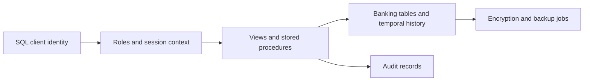

# SmartBankDB — SQL Server Security Coursework

A team coursework implementation of database security controls for a fictional retail bank. The project uses T-SQL to explore confidentiality, integrity and availability: roles, restricted views, controlled writes, audit trails, encryption, temporal history and recovery procedures.

**Private repository. Status:** source and feature/test organization reviewed; runtime behavior has not been independently verified in this pass. There is no separate web or desktop application.

## Architecture and scope



The consolidated implementation is `Full Code Implementation/SmartBankDB_Codebase.sql`; `SmartBankDB_FeatureTests.sql` supplies seed/test material. Earlier task scripts and per-role tests show the team's development and demonstration work. File names identify multiple contributors; this repository does not claim sole authorship of every control.

## Review and reproduce

```bash
python docs/verify_offline.py
```

The offline check inventories SQL files and confirms control-related statements in the consolidated source. **It is a static inspection, not a SQL syntax validator or a passing security test.** [Captured output](docs/results.txt).

For runtime work, use a disposable SQL Server lab instance with the required feature support and SQL Server Agent. Read the complete setup/order guidance before execution, replace demo passwords and instance paths, create the configured audit/key/backup directories, then run the consolidated code and scoped feature tests. The scripts alter database/server objects and must not be run blindly against an existing shared instance.

## Material limitations

The source includes demonstration credentials, environment-specific paths and deployment-order dependencies. Session-context identity, owner-executed procedures, permission interactions and recovery behavior require adversarial runtime checks. A five-minute backup schedule is a design intention; no measured recovery-point or recovery-time guarantee was established.

Local `.vs` workspace files are now ignored and removed from the current tracked tree while remaining on disk. Existing source and coursework tests are retained.

## Documentation

- [Full architecture, task mapping, setup and known issues](docs/PROJECT_GUIDE.md)
- [Verification and runtime blockers](docs/VERIFICATION.md)

This is a learning implementation using fictional banking data, not a production banking security system.
