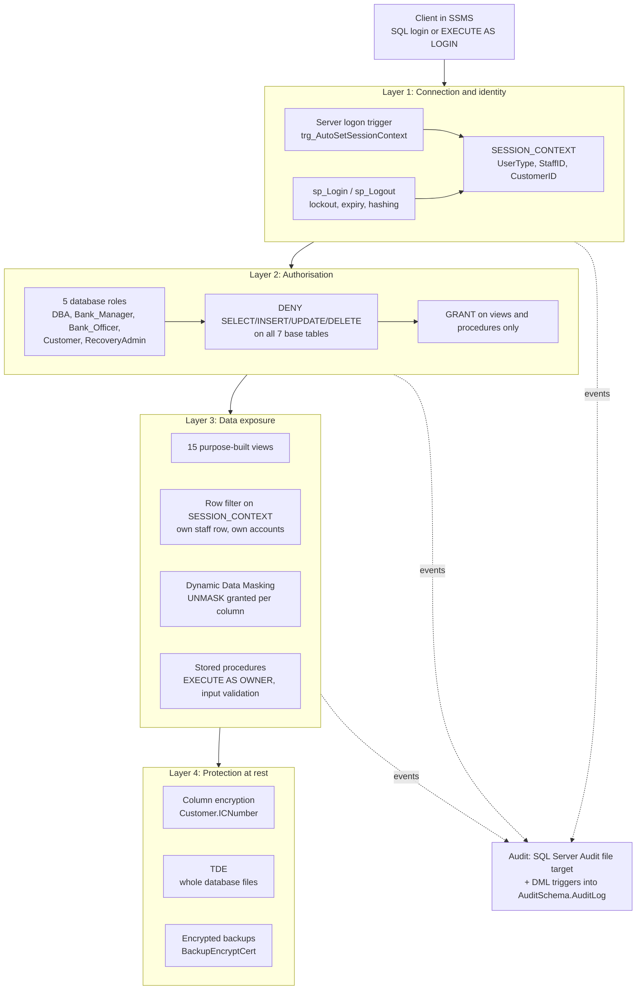
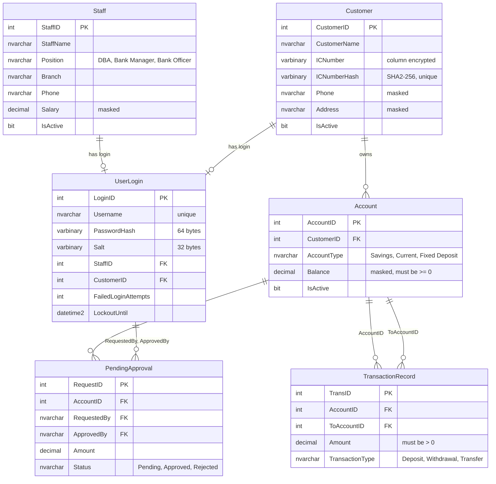
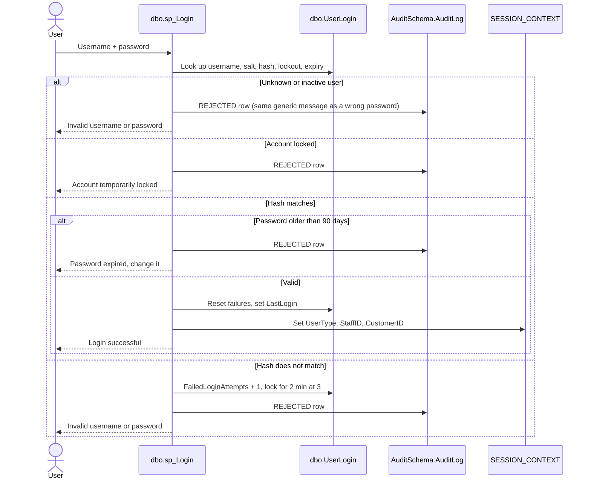
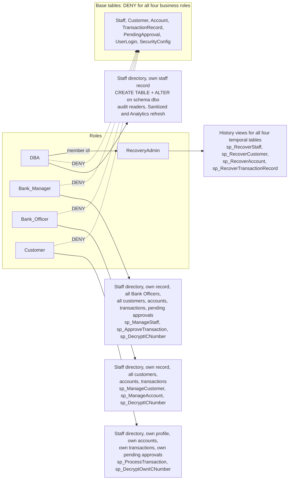
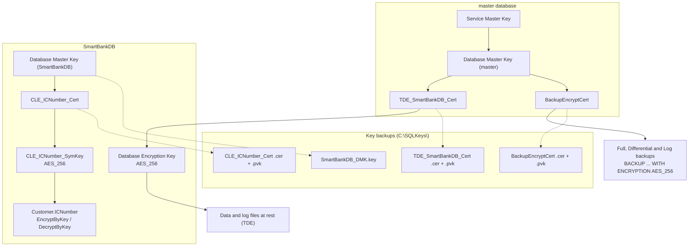
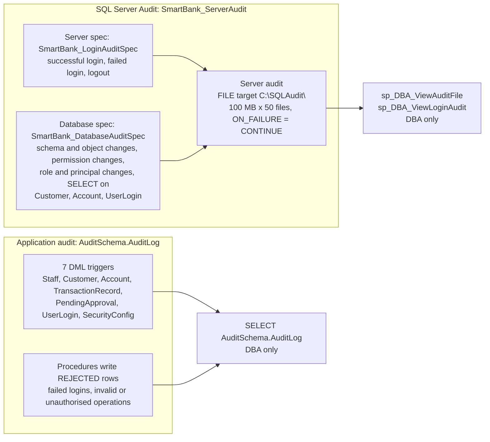
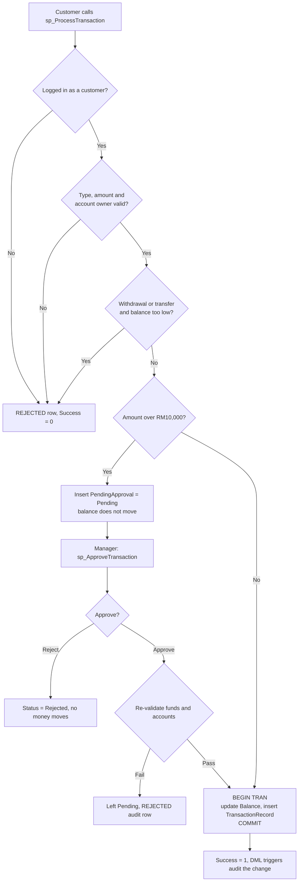
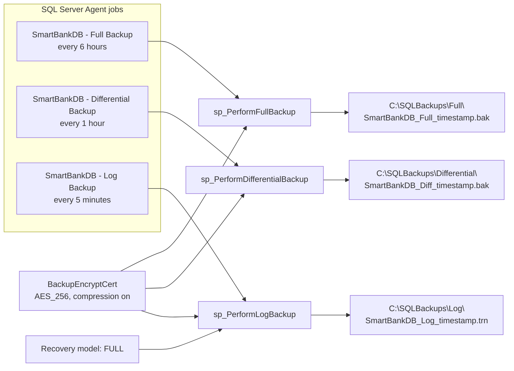

# SmartBankDB: SQL Server Security Architecture

A pure T-SQL project that secures a small retail-banking database (`SmartBankDB`) on Microsoft SQL Server. It was built by a student team as a database-security assignment and covers the three pillars of the CIA triad: **Confidentiality** (authentication, role-based access, views, row filtering, masking, encryption), **Integrity** (write-only-through-procedures, validation, approval workflow, audit triggers) and **Availability** (temporal history, point-in-time row recovery, encrypted and automated backups).

There is no application layer. Everything, including the "login system", is implemented inside the database with stored procedures, views, `SESSION_CONTEXT`, SQL Server Audit, TDE, column-level encryption and SQL Server Agent jobs. The repository also contains the earlier per-task scripts each teammate wrote, the consolidated "Full Code Implementation", a live-demo script, and a large set of per-role test scripts.

> **Important:** this is a coursework / learning project. Every script contains demo credentials, key passwords and fictional seed data. Replace every password placeholder before running anything outside a throw-away lab instance. See [Security notes](#security-notes).

---

## Table of contents

1. [What it does](#what-it-does)
2. [Technology](#technology)
3. [Layered security architecture](#layered-security-architecture)
4. [Database design](#database-design)
5. [Authentication and session identity](#authentication-and-session-identity)
6. [Roles and permissions (RBAC)](#roles-and-permissions-rbac)
7. [Views, masking and row filtering](#views-masking-and-row-filtering)
8. [Encryption](#encryption)
9. [Auditing](#auditing)
10. [Integrity: write procedures and the approval workflow](#integrity-write-procedures-and-the-approval-workflow)
11. [Availability: history, recovery and backups](#availability-history-recovery-and-backups)
12. [Project structure](#project-structure)
13. [Setup and run order](#setup-and-run-order)
14. [Script reference](#script-reference)
15. [Code walkthrough](#code-walkthrough)
16. [Testing evidence](#testing-evidence)
17. [Known issues, limitations and next steps](#known-issues-limitations-and-next-steps)
18. [Security notes](#security-notes)

---

## What it does

`SmartBankDB` models a bank with four kinds of user and five business tables. The scripts then lock it down so that each user type can only do what the brief allows.

| Pillar | Control | Where it lives |
|---|---|---|
| Confidentiality | Salted SHA2-512 password hashes, lockout after repeated failures, password expiry, complexity rules | Part 1 of `SmartBankDB_Codebase.sql` |
| Confidentiality | Four database roles, explicit `DENY` on every base table, access only through views and procedures | Parts 2 and 3 |
| Confidentiality | "Own data only" row filtering driven by `SESSION_CONTEXT` | Part 4 |
| Confidentiality | Dynamic Data Masking on `Salary`, `Phone`, `Address`, `Balance` with column-scoped `UNMASK` | Parts 0 and 3 |
| Confidentiality | TDE for the whole database, AES-256 column encryption for `Customer.ICNumber`, certificate and key backups | Part 6 |
| Confidentiality | Static masking (`Sanitized` schema) and anonymisation (`Analytics` schema) for dev and reporting copies | Part 6B |
| Confidentiality / Integrity | SQL Server Audit (logins, schema, permissions, sensitive reads) plus DML audit triggers into `AuditSchema.AuditLog` | Parts 5 and 7 |
| Integrity | Business writes only through procedures (`sp_ManageStaff`, `sp_ManageCustomer`, `sp_ManageAccount`, `sp_ProcessTransaction`, `sp_ApproveTransaction`, ...) | Part 8 |
| Integrity | `CHECK` / `FOREIGN KEY` constraints, DDL trigger that stops anyone switching off temporal versioning | Parts 0 and 2 |
| Availability | System-versioned (temporal) tables and four `sp_Recover*` procedures | Part 9 |
| Availability | Encrypted Full / Differential / Log backups on SQL Server Agent schedules (5-minute RPO) | Part 10 |

---

## Technology

| Technology | Role |
|---|---|
| T-SQL on Microsoft SQL Server (scripts mention SQL Server 2022; the restore script uses an `MSSQL16` instance path) | Language and platform |
| SQL Server Management Studio (SSMS) | Used to run scripts and for the multi-tab live demo (the repo includes a Visual Studio `.vs` folder) |
| System-versioned temporal tables | Row history and point-in-time recovery |
| Dynamic Data Masking | Display-time masking of sensitive columns |
| `SESSION_CONTEXT` + views | Application-level identity and row filtering |
| Transparent Data Encryption (TDE) | Whole-database encryption at rest |
| Column-level encryption (certificate + AES-256 symmetric key) | `Customer.ICNumber` |
| `HASHBYTES('SHA2_512')` + `CRYPT_GEN_RANDOM` | Salted password hashing |
| SQL Server Audit (file target) + audit specifications | Native login, schema, permission and read auditing |
| DML and DDL triggers, server logon trigger | Audit trail, versioning protection, automatic session identity |
| SQL Server Agent | Scheduled backup jobs |
| `BACKUP ... WITH ENCRYPTION` (certificate based) | Encrypted backups |

---

## Layered security architecture

A request passes through several independent layers. Compromising one does not give access to the data.



---

## Database design

Five business tables are system-versioned (temporal), each with an automatically created history table (`Staff_History`, `Customer_History`, `Account_History`, `TransactionRecord_History`). `PendingApproval`, `UserLogin` and `SecurityConfig` are ordinary tables. Audit rows live in a separate schema, `AuditSchema`, so the DBA's table-management rights (`dbo` schema only) never reach them.



Other objects created by `SmartBankDB_Codebase.sql`:

| Object | Purpose |
|---|---|
| `dbo.SecurityConfig` | Lockout and expiry policy values: `MaxFailedAttempts = 3`, `LockoutMinutes = 2`, `PasswordExpiryDays = 90` |
| `AuditSchema.AuditLog` | Custom audit trail (`TableName`, `ColumnName`, `RecordID`, `Activity`, `ChangedBy`, `ActionType` of `INSERT`/`UPDATE`/`DELETE`/`REJECTED`, `ChangeDate`) |
| `Sanitized.Customer_Sanitized`, `Sanitized.Staff_Sanitized` | Statically masked copies for development |
| `Analytics.Account_Anonymized`, `Analytics.TransactionRecord_Anonymized` | Anonymised copies for reporting |

Notable constraints: a `Transfer` must have a `ToAccountID` and may not target the same account; deposits and withdrawals must not have one; a `PendingApproval` row must carry `ApprovedBy` and `ApprovalDate` exactly when its status is `Approved` or `Rejected`; `UserLogin` is either a Staff login or a Customer login, never both.

---

## Authentication and session identity

The database has its own application-level login system on top of SQL Server logins. A successful login writes the caller's identity into `SESSION_CONTEXT`, and every view and procedure reads it from there.



Key points, all verified in `SmartBankDB_Codebase.sql` Part 1:

- **Hashing:** `SHA2_512(salt + UTF-16 password)`, 64-byte hash, 32-byte salt from `CRYPT_GEN_RANDOM`. Plaintext passwords are never stored or compared.
- **Generic errors:** unknown user, inactive user and wrong password all return the same message, so usernames cannot be enumerated.
- **Lockout and expiry** come from `dbo.SecurityConfig`, not from constants inside the procedure.
- **Complexity** (`fn_ValidatePasswordComplexity`): at least 8 characters with an upper-case letter, a lower-case letter, a digit and a symbol. Enforced by `sp_ChangePassword` and `sp_SetPassword`.
- **Claimed identity in the audit:** rejected attempts record "Attempted as: user, role" in `Activity` without ever trusting it as the verified `ChangedBy`.
- **Automatic identity (Part 11):** a server-level `LOGON` trigger, `trg_AutoSetSessionContext`, fills `SESSION_CONTEXT` the moment one of the eight named native logins connects, so a demo user can query the "own data" views without calling `sp_Login`. It is wrapped in `TRY/CATCH` so a trigger error can never block a login, and it can be disabled with `DISABLE TRIGGER trg_AutoSetSessionContext ON ALL SERVER;`.
- **Provisioning:** `sp_ManageStaff` and `sp_ManageCustomer` create a login for each new person with a random temporary password that is created already expired, so the first login forces a password change.

The eight demo identities seeded by Part 12 (native SQL login, application username, database role):

| Native login / app username | Role |
|---|---|
| `SmartBank_Manager1`, `SmartBank_Manager2` | `Bank_Manager` |
| `SmartBank_DBA1`, `SmartBank_DBA2` | `DBA` (and, through nesting, `RecoveryAdmin`) |
| `SmartBank_Officer1`, `SmartBank_Officer2` | `Bank_Officer` |
| `SmartBank_Customer1`, `SmartBank_Customer2` | `Customer` |

Passwords for these accounts are hard-coded in the scripts; replace them (see [Security notes](#security-notes)).

---

## Roles and permissions (RBAC)



Permission matrix (as granted in `SmartBankDB_Codebase.sql`; `DENY` on base tables is implicit in every column):

| Capability | DBA | Bank_Manager | Bank_Officer | Customer |
|---|---|---|---|---|
| `vw_StaffDirectory` (name and phone, only after authentication) | yes | yes | yes | yes |
| `vw_StaffOwnRecord` (own row only) | yes | yes | yes | no |
| `vw_AllBankOfficers` | no | yes | no | no |
| `vw_CustomerAll`, `vw_AccountAll`, `vw_TransactionAll` | no | yes | yes | no |
| `vw_PendingApprovalAll` | no | yes | no | no |
| `vw_CustomerOwnProfile`, `vw_AccountOwn`, `vw_TransactionOwn`, `vw_PendingApprovalOwn` | no | no | no | yes |
| `sp_ManageStaff` (Bank Officer records only) | no | yes | no | no |
| `sp_ManageCustomer`, `sp_ManageAccount` | no | no | yes | no |
| `sp_UpdateOwnStaffRecord` (own phone only) | yes | yes | yes | no |
| `sp_ProcessTransaction` (own accounts) | no | no | no | yes |
| `sp_ApproveTransaction` | no | yes | no | no |
| `sp_DecryptICNumber` (any customer) | no | yes | yes | no |
| `sp_DecryptOwnICNumber` | no | no | no | yes |
| `CREATE TABLE`, `ALTER` on schema `dbo` | yes | no | no | no |
| `AuditSchema.AuditLog`, `sp_DBA_ViewAuditFile`, `sp_DBA_ViewLoginAudit` | yes | no | no | no |
| `sp_RefreshDevData`, `sp_RefreshAnalyticsData` | yes | no | no | no |
| History views and `sp_Recover*` (via `RecoveryAdmin`) | yes | no | no | no |
| `sp_Login`, `sp_Logout`, `sp_ChangePassword` | `PUBLIC` | `PUBLIC` | `PUBLIC` | `PUBLIC` |

Design decisions worth noting:

- **DBA manages structure, not data.** `DBA` gets `CREATE TABLE` and `ALTER ON SCHEMA::dbo` instead of the broader `db_ddladmin`, because `db_ddladmin` would also reach `AuditSchema`.
- **`RecoveryAdmin` exists so `DBA`'s own grants stay minimal.** DBA is nested as a member and inherits history and recovery rights.
- **`DENY` is deliberate.** `DENY` always beats `GRANT`, so even an accidental later `GRANT SELECT` on a base table has no effect for these roles.
- **`VIEW SERVER SECURITY AUDIT`** (a SQL Server 2022 permission) is granted to `SmartBank_DBA1` and `SmartBank_DBA2` so they can read audit files without `CONTROL SERVER`. Each additional DBA login needs the same grant.

---

## Views, masking and row filtering

All 15 views are `dbo`-owned, so ownership chaining lets a role query a view without any permission on the base table underneath.

| Group | Views |
|---|---|
| Staff | `vw_StaffDirectory`, `vw_StaffOwnRecord`, `vw_AllBankOfficers` |
| Customer and account | `vw_CustomerAll`, `vw_CustomerOwnProfile`, `vw_AccountAll`, `vw_AccountOwn` |
| Transaction and approval | `vw_TransactionAll`, `vw_TransactionOwn`, `vw_PendingApprovalAll`, `vw_PendingApprovalOwn` |
| History (RecoveryAdmin) | `vw_Staff_History`, `vw_Customer_History`, `vw_Account_History`, `vw_TransactionRecord_History` |

**Row filtering** is done inside the "Own" views with `WHERE ... = CAST(SESSION_CONTEXT(N'StaffID') AS INT)` (or `CustomerID`). With no login, `SESSION_CONTEXT` is `NULL`, the comparison is never true, and the view returns no rows (fail closed). `vw_StaffDirectory` additionally requires `SESSION_CONTEXT(N'UserType') IS NOT NULL`, so being in a role is not enough: the session must have authenticated.

**Dynamic Data Masking** is applied to four columns:

| Column | Mask | Unmasked for |
|---|---|---|
| `Staff.Salary` | `default()` | DBA, Bank_Manager, Bank_Officer (column-scoped `UNMASK`) |
| `Customer.Phone` | `partial(0,"XXXX",4)` | Bank_Manager, Bank_Officer, Customer |
| `Customer.Address` | `default()` | Bank_Manager, Bank_Officer, Customer |
| `Account.Balance` | `default()` (shows `0.00`) | see the note below |

> **Discrepancy to be aware of:** the comment at line 852 of `SmartBankDB_Codebase.sql` and the feature tests say a `Bank_Officer` must see `Balance` as `0.00`, but line 854 of the same file grants `UNMASK` on `Account.Balance` to `Bank_Officer`. As written, the grant would let officers see real balances. Remove that one line to match the documented design. (The older standalone `Confidentiality_T1_Salsabila.sql` follows the documented design and never grants `UNMASK` to the officer role.)

---

## Encryption

Three separate mechanisms, each protecting a different thing.



| Mechanism | Protects | Scripts |
|---|---|---|
| **TDE** (`CREATE DATABASE ENCRYPTION KEY ... AES_256`, `ALTER DATABASE SmartBankDB SET ENCRYPTION ON`) | Database files at rest | Part 6 (`[C2.6]` to `[C2.9]`) |
| **Column-level encryption** with a certificate-protected AES-256 symmetric key | `Customer.ICNumber` (stored as `VARBINARY(MAX)`), plus an unencrypted-column `ICNumberHash` (SHA2-256) used for duplicate detection | Part 6 (`[C2.1]` to `[C2.5]`) |
| **Encrypted backups** (`BackupEncryptCert`, AES-256) | Every Full, Differential and Log backup | Part 10 |

How IC numbers are exposed:

- Nobody has direct access to the key or certificate. `sp_DecryptICNumber` (Manager, Officer) and `sp_DecryptOwnICNumber` (Customer) are `EXECUTE AS OWNER` wrappers that open the key, decrypt and close it.
- `sp_DecryptOwnICNumber` has no parameter: it reads the caller's `CustomerID` from `SESSION_CONTEXT`, so a customer can only ever decrypt their own row.
- `DBA` is not granted either procedure and cannot open the key.
- The seed data originally used `ENCRYPTBYPASSPHRASE` with a placeholder phrase. Part 6 re-encrypts any such rows to the real symmetric key (`[C2.4]`).
- The audit trigger records `ICNumber` changes as `<encrypted value changed>` and never writes plaintext.

**Key backup files** go to `C:\SQLKeys\` and must be protected. Losing `CLE_ICNumber_Cert` makes `ICNumber` permanently unreadable, and losing the TDE or backup certificate makes the database and its backups unrestorable on another server. Each backup is protected by a password that is **hard-coded in the scripts**; use a unique, vaulted value in any real deployment.

---

## Auditing

Two complementary audit systems.



| Layer | What it captures | Read by |
|---|---|---|
| `SmartBank_LoginAuditSpec` (server) | `SUCCESSFUL_LOGIN_GROUP`, `FAILED_LOGIN_GROUP`, `LOGOUT_GROUP` | `sp_DBA_ViewLoginAudit` (login, client host, event, outcome, time) |
| `SmartBank_DatabaseAuditSpec` | `SCHEMA_OBJECT_CHANGE_GROUP`, `DATABASE_OBJECT_CHANGE_GROUP`, `DATABASE_PERMISSION_CHANGE_GROUP`, `SCHEMA_OBJECT_PERMISSION_CHANGE_GROUP`, and `SELECT` on `dbo.Customer`, `dbo.Account`, `dbo.UserLogin` | `sp_DBA_ViewAuditFile` |
| Add-on: `DATABASE_PRINCIPAL_CHANGE_GROUP addition.sql` | Adds `DATABASE_PRINCIPAL_CHANGE_GROUP` and `DATABASE_ROLE_MEMBER_CHANGE_GROUP` to the database spec (users added, role membership changed) | same |
| DML audit triggers | One row per changed column with `old -> new`, or a full row description on insert/delete; `ICNumber` and password hashes are redacted | `AuditSchema.AuditLog` (DBA only) |
| `REJECTED` rows | Failed logins, failed password changes, invalid transactions, out-of-scope staff updates | `AuditSchema.AuditLog` |

The audit specifications are created in the `OFF` state and switched on together at the end of Part 5 (`[C6.6]`). Both audit procedures check `IS_MEMBER('DBA')` as a second line of defence behind the `GRANT EXECUTE`.

`ChangedBy` comes from `dbo.fn_GetSessionUsername()`, which resolves the `SESSION_CONTEXT` identity to `username (Role)` and falls back to `SUSER_NAME()` when nobody is logged in.

---

## Integrity: write procedures and the approval workflow

Roles have no `INSERT` / `UPDATE` / `DELETE` rights on any base table. All business writes go through procedures that run `WITH EXECUTE AS OWNER`, validate their inputs, and write a `REJECTED` audit row when they refuse.

| Procedure | Caller | Rules enforced |
|---|---|---|
| `sp_ManageStaff` | Bank_Manager | Creates or updates **Bank Officer** records only; `Position` cannot be changed; required fields and positive salary; auto-provisions a login |
| `sp_ManageCustomer` | Bank_Officer | 12-digit IC number on create, duplicate check through `ICNumberHash`, IC encrypted with the CLE key, IC not editable afterwards; auto-provisions a login |
| `sp_ManageAccount` | Bank_Officer | No `@Balance` parameter at all, new accounts start at RM0.00, cannot open an account for an inactive customer, cannot close an account with a non-zero balance |
| `sp_UpdateOwnStaffRecord` | DBA, Manager, Officer | Updates the caller's own **phone number only** (no `@StaffID` parameter, so nobody can target another row) |
| `sp_ProcessTransaction` | Customer | Deposit, withdrawal, transfer on **own** active accounts; positive amount; sufficient funds; amounts over RM10,000 are routed to approval |
| `sp_ApproveTransaction` | Bank_Manager | Approves or rejects a pending request; re-validates balance and account status before moving money; refuses to act twice on a request |



The RM10,000 approval threshold is a hard-coded value inside `sp_ProcessTransaction` and is described in the script as the team's own extension, not a brief requirement.

A database-level DDL trigger, `trg_PreventVersioningDisable`, rolls back `ALTER TABLE ... SYSTEM_VERSIONING = OFF` and `DROP COLUMN` on the four temporal tables, even for the DBA, because either would silently destroy the recovery trail.

---

## Availability: history, recovery and backups

### Row-level recovery with temporal tables

`sp_RecoverStaff`, `sp_RecoverCustomer`, `sp_RecoverAccount` and `sp_RecoverTransactionRecord` (granted to `RecoveryAdmin`) take an ID and an `@AsOfDateTime`:

- If the row **still exists**, it is rolled back to its state at that moment (accidental update).
- If the row **was deleted**, it is re-inserted with its **original identity value** using `IDENTITY_INSERT` (accidental delete).
- `Customer` restores `ICNumber` as its original encrypted bytes, so no re-encryption is needed.

A timestamp is easiest to find from the matching history view, for example `SELECT ... FROM dbo.vw_Customer_History WHERE CustomerID = ... ORDER BY SysEndTime DESC`.

### Backup strategy



| Item | Value (from `SmartBankDB_Codebase.sql`, Part 10) |
|---|---|
| Recovery model | `FULL` (set in `[B2]`) |
| Full backup | every 6 hours, job `SmartBankDB - Full Backup` |
| Differential backup | every 1 hour, job `SmartBankDB - Differential Backup` |
| Log backup | every 5 minutes, job `SmartBankDB - Log Backup`; **RPO is 5 minutes** |
| Options | `INIT`, `COMPRESSION`, `ENCRYPTION (ALGORITHM = AES_256, SERVER CERTIFICATE = BackupEncryptCert)` |
| First backup | `[B4]` runs one Full backup immediately to start the log chain |
| Certificate backup | `[B6]` exports `BackupEncryptCert` and its private key to `C:\SQLKeys\` |

No recovery-time objective (RTO) is defined in the scripts.

### Restoring an encrypted backup on another instance

`Full Code Implementation/RestoreEncryptedBackup.sql` and section 6 of `SQLQuery_Demo.sql` walk through restoring on a second instance:

1. Grant the target instance's service account read access to the exported `.cer` / `.pvk` files and the `.bak` file.
2. In `master` on the target, create a database master key (if missing), then recreate `TDE_SmartBankDB_Cert` and `BackupEncryptCert` **from the exported files**.
3. Restore the full backup under a new name (for example `SmartBankDB_RestoreProof`), relocating the `.mdf` / `.ldf`.
4. For `ICNumber`, also import `CLE_ICNumber_Cert` and re-open the database master key, then decrypt through the symmetric key.

The script states that the restore itself must be demonstrated on the user's own instance.

---

## Project structure

```
SQL-Server-Security-Architecture/
├── SQL_Database_Security_Baseline.sql       # Schema + seed data (16 staff, 20 customers, 24 accounts, 36 logins)
├── SQL_Database_Baseline.sql                # Earliest draft schema (superseded, see Known issues)
│
├── 4.1_authentication (Confidetiality-Abdallah-T1&T2).sql   # sp_Login, sp_Logout, sp_ChangePassword (first version)
├── 4.2_authorization_rbac (Confidetiality-Abdallah-T3).sql  # Roles + DENY on base tables (first version)
├── 4.3_views (Confidetiality-Abdallah-T4).sql               # Views (first version)
├── 4.4_row_level_security (Confidetiality-Abdallah-T5).sql  # SESSION_CONTEXT row filtering (first version)
│
├── Confidentiality_T1_Salsabila.sql         # C1  Dynamic Data Masking on Account.Balance
├── Confidentiality_T2_Salsabila.sql         # C2  TDE + column-level encryption + key backups
├── Confidentiality_T3_Salsabila.sql         # C3  Password hashing and salting
├── Confidentiality_T4_Salsabila.sql         # C4  Static data masking (separate SmartBankDB_Dev database)
├── Confidentiality_T5_Salsabila.sql         # C5  Anonymisation (separate SmartBankDB_Analytics database)
├── Confidentiality_T6_Salsabila.sql         # C6  SQL Server Audit
├── Confidentiality_T7_Salsabila.sql         # C7  Login/logout audit reader
│
├── Full Code Implementation/                # The consolidated, final system
│   ├── SmartBankDB_Codebase.sql             # Parts 0-12: everything, run top to bottom
│   ├── SmartBankDB_FeatureTests.sql         # 9-step feature test suite
│   ├── SQLQuery_Demo.sql                    # Multi-tab live demo walkthrough
│   ├── RestoreEncryptedBackup.sql           # Prepare a second instance for an encrypted restore
│   ├── Manager Delete Option.sql            # Add-on: sp_ManageStaff with CREATE/UPDATE/DELETE actions
│   ├── DATABASE_PRINCIPAL_CHANGE_GROUP addition.sql  # Add-on: audit user and role-membership changes
│   ├── Unmasking for DBA.sql                # Add-on: UNMASK Account.Balance for DBA
│   ├── DBA Selection and Recovery.sql       # Add-on: SELECT on temporal tables for DBA
│   └── Grant execute on BankOfficer.sql     # Add-on: EXECUTE sp_DecryptICNumber for Bank_Officer
│
└── Testing/
    ├── Backup Restore Testing and Fixing.sql
    ├── Testing for part 6.sql, Testing 3 DBA 1.sql, Testing 3 Bank Officer1.sql
    ├── Testing Bank Officer 1/2.sql, Testing Customer 1.sql, Testing DBA 1/2.sql
    ├── Testing Staff Detail Manager 1/2.sql, Staff Detail Manager 1.sql
    ├── Testing 2 ... (Bank Officer 1/2, Customer 1, DBA 1, Staff Detail Manager 2)
    ├── Test 2/Test 2 - Permission Settings And Its Users for each role.sql
    └── Final Test Scripts/                  # One folder per requirement, one script per identity
        ├── Confidentiality/{Bank Manager, Bank Officer, Customer, DBA}/SmartBank_<Role><n>/
        ├── Integrety/{Bank Manager, Bank Officer, Customer, DBA}/SmartBank_<Role><n>/
        ├── Audit Records/DDL Changes for table alters.sql
        ├── New Users/DBA/   (Adding New User DBA.sql, New User Test for DBA.sql)
        ├── Requirement 8/Sample code for permission changes.sql
        ├── requirement 9/requirement 9 using officer.sql
        ├── Recovery Code Instant.sql
        └── users and the permission settings for each role.sql
```

> The repository also contains a committed Visual Studio `.vs/` folder (workspace cache). It is not part of the project and can be ignored.

---

## Setup and run order

### 1. Prerequisites

- Microsoft SQL Server with **SQL Server Agent running** (the scripts target SQL Server 2022; TDE, backup encryption and Agent need a suitable edition such as Developer or Enterprise, and Express has no Agent).
- SSMS, connected as a **sysadmin** login. Parts 5, 6, 10 and 11 create server-level objects (audit, certificates, logon trigger, logins).
- These folders must exist and be writable by the SQL Server service account:

```
C:\SQLAudit\
C:\SQLKeys\
C:\SQLBackups\Full\
C:\SQLBackups\Differential\
C:\SQLBackups\Log\
```

- **Before running anything**, search the scripts for `PASSWORD`, `P@ss` and `Pass2026`, and replace each hard-coded password with a value you generate yourself. Use the same replacement consistently for each key (the master-key, key-backup and login passwords are referenced again by the restore scripts).

### 2. Recommended path: the consolidated system

Run these in order. Each file is a batch script (`GO` separators); run it as a whole, except the feature tests, which are designed to be run block by block.

| Step | Script | What it does |
|---|---|---|
| 1 | `Full Code Implementation/SmartBankDB_Codebase.sql` | Creates `SmartBankDB` and all tables (Part 0); authentication (1); roles and DENY rules, DDL trigger (2); views (3); row filtering (4); SQL Server Audit (5); TDE and column encryption (6); static masking and anonymisation (6B); DML audit triggers (7); write procedures (8); recovery procedures (9); backup procedures, Agent jobs and an initial Full backup (10); logon trigger (11); seeds the eight demo identities (12) |
| 2 | `Full Code Implementation/SmartBankDB_FeatureTests.sql` *(optional)* | Seeds five more test users (`mgr_test`, `dba_test`, `ofc_test`, `cust1_test`, `cust2_test`) and runs a nine-step test suite. See the note below about the role logins it expects |
| 3 | `Full Code Implementation/Manager Delete Option.sql` *(optional add-on)* | Replaces `sp_ManageStaff` with a `CREATE` / `UPDATE` / `DELETE` version, used by the `Final Test Scripts` |
| 4 | `Full Code Implementation/DATABASE_PRINCIPAL_CHANGE_GROUP addition.sql` *(optional add-on)* | Adds user and role-membership change auditing |
| 5 | `Full Code Implementation/Unmasking for DBA.sql`, `DBA Selection and Recovery.sql`, `Grant execute on BankOfficer.sql` *(optional add-ons)* | Extra grants, see [Script reference](#script-reference) for their effect |
| 6 | `Full Code Implementation/SQLQuery_Demo.sql` | Live demo: open several SSMS tabs, one per SQL login, and run the numbered sections in the tab named in each comment |
| 7 | `Full Code Implementation/RestoreEncryptedBackup.sql` | On a **second** SQL Server instance only, to prove an encrypted backup can be restored |

> **Feature-test prerequisite.** `SmartBankDB_FeatureTests.sql` impersonates `SmartBank_Manager`, `SmartBank_Officer`, `SmartBank_Customer` and `SmartBank_DBA` with `EXECUTE AS LOGIN`. `SmartBankDB_Codebase.sql` only creates the numbered logins (`SmartBank_Manager1`, ...), and no script in the repository creates the four un-numbered role logins. Create them (and map each to its database role) before running the tests.

### 3. Alternative path: the original per-task scripts

These are the first versions each teammate wrote against the seeded baseline. Run on a **fresh** server, in this order:

1. `SQL_Database_Security_Baseline.sql` (schema plus seed data, including placeholder password hashes and placeholder-encrypted IC numbers)
2. `4.1_...T1&T2`, `4.2_...T3`, `4.3_...T4`, `4.4_...T5` (the `4.x` files)
3. `Confidentiality_T1` through `T7` in numeric order

These scripts include their own test cases at the bottom and create test logins. Do not mix them with the consolidated codebase on the same database: they use different table names (`dbo.AuditLog` instead of `AuditSchema.AuditLog`), a different password-hash byte order, and separate dev / analytics databases. The consolidated `SmartBankDB_Codebase.sql` supersedes them.

---

## Script reference

| File | Purpose | Notes |
|---|---|---|
| `SQL_Database_Security_Baseline.sql` | Creates `SmartBankDB`, five temporal tables, `UserLogin`, `AuditLog`, `PendingApproval`, then seeds 16 staff, 20 customers, 24 accounts, 36 logins, about 185 transactions and 1 pending approval | Seed data is fictional; hashes and IC encryption are placeholders |
| `SQL_Database_Baseline.sql` | Earliest schema draft | Not used by later scripts; see Known issues |
| `4.1_authentication ...` | First `sp_Login`, `sp_Logout`, `sp_ChangePassword`, lockout, expiry, complexity check | Adds `PasswordLastChanged` and `SecurityConfig` |
| `4.2_authorization_rbac ...` | Four roles, `DENY` on five base tables, `db_ddladmin` for DBA, four test logins | Superseded by Part 2 |
| `4.3_views ...` | The original 14 views and grants | Superseded by Part 3 |
| `4.4_row_level_security ...` | Adds `SESSION_CONTEXT` filters to the four "Own" views | Superseded by Part 4 |
| `Confidentiality_T1_Salsabila.sql` | Dynamic Data Masking on `Account.Balance`, database-wide `UNMASK` for Manager and Customer | Consolidated version uses column-scoped `UNMASK` |
| `Confidentiality_T2_Salsabila.sql` | TDE, CLE, `sp_DecryptICNumber`, key and certificate backups | Folder `C:\SQLKeys\` required |
| `Confidentiality_T3_Salsabila.sql` | `fn_HashPassword`, `sp_SetPassword`, `fn_VerifyPassword`; resets seed accounts to one demo password | Hashes `password + salt`; the consolidated codebase hashes `salt + password`, so hashes are not interchangeable |
| `Confidentiality_T4_Salsabila.sql` | Static masking into a separate `SmartBankDB_Dev` database using fake name and street pools | Consolidated version uses a `Sanitized` schema instead |
| `Confidentiality_T5_Salsabila.sql` | Anonymisation into a separate `SmartBankDB_Analytics` database with one random surrogate per customer per run | Consolidated version uses an `Analytics` schema instead |
| `Confidentiality_T6_Salsabila.sql` | Server audit, specifications, `sp_DBA_ViewAuditFile` | Uses `ALTER SERVER AUDIT` without creating it first; the consolidated version adds the `CREATE` |
| `Confidentiality_T7_Salsabila.sql` | `sp_DBA_ViewLoginAudit` | |
| `Full Code Implementation/SmartBankDB_Codebase.sql` | The complete system, Parts 0 to 12 | Needs sysadmin, folders and Agent |
| `Full Code Implementation/SmartBankDB_FeatureTests.sql` | Nine-step test suite, each block with an `EXPECT` comment | See feature-test prerequisite |
| `Full Code Implementation/SQLQuery_Demo.sql` | Demo walkthrough, nine requirement sections plus examiner Q&A and troubleshooting appendices | Needs five SSMS tabs |
| `Full Code Implementation/RestoreEncryptedBackup.sql` | Second-instance preparation and manual restore instructions | Contains a machine-specific instance name |
| `Full Code Implementation/Manager Delete Option.sql` | `sp_ManageStaff` with `@Action` of `CREATE` / `UPDATE` / `DELETE`; redefines `vw_StaffDirectory` | See Known issues: removes the "Bank Officer only" check and widens the directory view |
| `Full Code Implementation/DATABASE_PRINCIPAL_CHANGE_GROUP addition.sql` | Adds `DATABASE_PRINCIPAL_CHANGE_GROUP` and `DATABASE_ROLE_MEMBER_CHANGE_GROUP` to the database audit spec | Turns the spec off and on again |
| `Full Code Implementation/Unmasking for DBA.sql` | `GRANT UNMASK` on `Account.Balance` to `DBA` | |
| `Full Code Implementation/DBA Selection and Recovery.sql` | `GRANT SELECT` on the four base tables and their history tables to `DBA` | The base-table grants are overridden by the existing `DENY`; the history-table grants take effect |
| `Full Code Implementation/Grant execute on BankOfficer.sql` | `GRANT EXECUTE ON sp_DecryptICNumber TO Bank_Officer` | Already granted in Part 6, so this is redundant |

---

## Code walkthrough

Passwords in the real scripts are hard-coded. In the excerpts below they are shown as placeholders.

### Row filtering through `SESSION_CONTEXT`

```sql
CREATE OR ALTER VIEW dbo.vw_AccountOwn AS
    SELECT AccountID, CustomerID, AccountType, Balance, IsActive
    FROM dbo.Account
    WHERE CustomerID = CAST(SESSION_CONTEXT(N'CustomerID') AS INT);
GO
GRANT SELECT ON dbo.vw_AccountOwn TO Customer;
```

A customer with no `SESSION_CONTEXT` value, or with someone else's ID, gets zero rows. The base table `dbo.Account` is `DENY`-ed to the role.

### Dynamic Data Masking with column-scoped unmasking

```sql
ALTER TABLE dbo.Customer
ALTER COLUMN Phone ADD MASKED WITH (FUNCTION = 'partial(0,"XXXX",4)');

GRANT UNMASK ON OBJECT::dbo.Customer (Phone) TO Bank_Manager;
```

`UNMASK` is granted per column rather than database-wide, so adding a new masked column later does not silently expose it.

### Encrypting and decrypting `ICNumber` without exposing the key

```sql
CREATE SYMMETRIC KEY CLE_ICNumber_SymKey
    WITH ALGORITHM = AES_256
    ENCRYPTION BY CERTIFICATE CLE_ICNumber_Cert;

CREATE OR ALTER PROCEDURE dbo.sp_DecryptOwnICNumber
WITH EXECUTE AS OWNER
AS
BEGIN
    DECLARE @CallerCustomerID INT = TRY_CAST(SESSION_CONTEXT(N'CustomerID') AS INT);
    IF @CallerCustomerID IS NULL
        THROW 51000, 'You must be logged in as a customer to use this.', 1;

    OPEN SYMMETRIC KEY CLE_ICNumber_SymKey
        DECRYPTION BY CERTIFICATE CLE_ICNumber_Cert;

    SELECT CustomerID,
           CONVERT(NVARCHAR(20), DecryptByKey(ICNumber)) AS ICNumber_Decrypted
    FROM dbo.Customer
    WHERE CustomerID = @CallerCustomerID;

    CLOSE SYMMETRIC KEY CLE_ICNumber_SymKey;
END;
GRANT EXECUTE ON dbo.sp_DecryptOwnICNumber TO Customer;
```

### The approval threshold in `sp_ProcessTransaction`

```sql
IF @Amount > @ApprovalThreshold          -- 10000.00
BEGIN
    INSERT INTO dbo.PendingApproval
        (AccountID, RequestedBy, Amount, TransactionType, ToAccountID, Status)
    VALUES (@AccountID, @CallerUsername, @Amount, @TransactionType, @ToAccountID, 'Pending');

    SET @Success = 1;
    SET @Message = 'Transaction exceeds RM10,000 and requires Manager approval. Submitted for review.';
    RETURN;
END
```

### Encrypted backups run by SQL Server Agent

```sql
BACKUP DATABASE SmartBankDB
TO DISK = N'C:\SQLBackups\Full\SmartBankDB_Full_<timestamp>.bak'
WITH INIT, COMPRESSION,
     ENCRYPTION (ALGORITHM = AES_256, SERVER CERTIFICATE = BackupEncryptCert),
     NAME = N'SmartBankDB-Full Backup';
```

The three `sp_Perform*Backup` procedures build the timestamped file name and run this through `sp_executesql`; the Agent jobs only call the procedures.

### Protecting the history trail

```sql
CREATE OR ALTER TRIGGER trg_PreventVersioningDisable
ON DATABASE
FOR ALTER_TABLE
AS
BEGIN
    -- If the table is Staff, Customer, Account or TransactionRecord and the command
    -- contains SYSTEM_VERSIONING ... OFF or DROP COLUMN, raise an error and ROLLBACK.
END;
```

A sysadmin who really must change this has to `DISABLE TRIGGER` first, which the database audit specification records.

### Placeholders for secrets

Every `CREATE MASTER KEY`, `BACKUP CERTIFICATE ... ENCRYPTION BY PASSWORD`, `CREATE CERTIFICATE ... DECRYPTION BY PASSWORD` and `CREATE LOGIN ... WITH PASSWORD` in the scripts should become:

```sql
CREATE MASTER KEY ENCRYPTION BY PASSWORD = '<replace-with-a-generated-secret>';
```

---

## Testing evidence

The repository contains test **scripts**, not captured results. There are no screenshots, result sets or log files in the repository, so none of the outcomes below are recorded as verified here. Each row says what the script is written to show; the `EXPECT` / `Expected` comments in the scripts define the intended outcome.

| Area | Script(s) | What it exercises | Intended outcome (from the script comments) |
|---|---|---|---|
| Whole system | `SmartBankDB_FeatureTests.sql` | Nine steps: setup, authentication, RBAC / RLS, column encryption, transaction integrity, audit, temporal recovery, backups, DDL trigger | Allowed calls return `Success = 1`; forbidden calls are denied or return `Success = 0`; the trigger blocks `SYSTEM_VERSIONING = OFF` |
| Authentication | FeatureTests step 2, `4.1_...` test cases | Unknown user, three wrong passwords then lockout, weak new password, password change, `sp_Logout` clearing the session | Generic error message, lockout with a future `LockoutUntil`, complexity rejection |
| RBAC and row isolation | FeatureTests step 3, `Final Test Scripts/Confidentiality/*`, `Testing 2/...` | Each role queries the views it should and fails on base tables, DDL and other roles' procedures; Customer 2 cannot see Customer 1's account or transactions; two officers see only their own staff row | Positive queries succeed, negative ones are denied, cross-customer queries return 0 rows |
| Masking | FeatureTests addendum C1 | `sys.masked_columns`, `UNMASK` grants, Manager vs Officer vs Customer reading `Balance`, masked arithmetic | Manager and Customer see real values, Officer sees `0.00` (see the discrepancy noted above) |
| Encryption | FeatureTests step 4 and C2 block, `requirement 9 using officer.sql`, `Testing for part 6.sql` | Ciphertext at rest, Manager / Officer / Customer decrypting through wrappers, DBA denied, direct key access denied, TDE `encryption_state = 3` | Readable IC only through the allowed wrapper |
| Hashing | FeatureTests C3 block | Hash length 64 / salt length 32, different salts and hashes for identical passwords, verify true / false, officer cannot call internals | `HashBytes = 64`, `SaltBytes = 32`, `CanAuthenticate = 1` |
| Static masking and anonymisation | FeatureTests C4 / C5 blocks | Row counts match, no identity leaks, one surrogate per customer per run, fresh surrogates each refresh, officer denied | Leak counts `0`, surrogate reuse count `0` |
| Integrity | FeatureTests step 5, `Final Test Scripts/Integrety/*`, `Testing Bank Officer 1/2.sql`, `Testing Customer 1.sql` | Deposit, withdrawal, transfer, overdraft, negative amount, someone else's account, RM15,000 deposit routed to approval then approved, manager and officer procedures, DBA table management | Business-rule violations return `Success = 0` with a specific message |
| Audit | FeatureTests step 6 and C6 / C7 blocks, `Final Test Scripts/Audit Records/DDL Changes for table alters.sql`, `New Users/DBA/*`, `Requirement 8/*` | Audit objects enabled, DML rows, `REJECTED` rows, login / logout events, permission changes and new users appearing in the audit file | Rows present in `AuditSchema.AuditLog` and in the `*.sqlaudit` file |
| Recovery | FeatureTests step 7, `Final Test Scripts/Recovery Code Instant.sql`, `Testing 2 DBA 1.sql`, `Testing DBA 1.sql` | Corrupt a phone number, branch, balance and transaction amount, then restore each through `sp_Recover*`; non-`RecoveryAdmin` users denied | Restored values match the pre-corruption values |
| Backups | FeatureTests step 8, `SQLQuery_Demo.sql` section 5, `Testing 3 DBA 1.sql`, `Backup Restore Testing and Fixing.sql` | Three Agent jobs exist and are enabled, recovery model is `FULL`, backup history in `msdb`, `RESTORE HEADERONLY` / `VERIFYONLY`, certificates imported on a second instance | Three enabled jobs, `FULL` recovery model, backup files encrypted and verifiable |

Several recovery scripts contain fixed `AsOfDateTime` values dated September 2026, which suggests they were run against a live instance, but the outputs were not committed. To reproduce the evidence, run the scripts yourself and capture the results.

---

## Known issues, limitations and next steps

**Defects and inconsistencies found while reading the code**

- **Officer can unmask balances.** `SmartBankDB_Codebase.sql` line 854 grants `UNMASK` on `Account.Balance` to `Bank_Officer`, contradicting the nearby comment and the feature tests that expect `0.00`.
- **`Manager Delete Option.sql` weakens earlier controls.** The replacement `sp_ManageStaff` drops the "Bank Officer records only" check, no longer writes `REJECTED` audit rows, no longer provisions a login on create, and its `DELETE` branch removes the linked `UserLogin` first. It also redefines `vw_StaffDirectory` to return `StaffID`, `Position`, `Branch` and `IsActive` with no authentication check, and because `CREATE OR ALTER` keeps the existing grants, every role including `Customer` can read that wider view.
- **Feature test references a view that does not exist.** `SmartBankDB_FeatureTests.sql` (the C6.5 permission-change block) grants on `dbo.vw_StaffOwn`; the view is named `vw_StaffOwnRecord`.
- **Missing role logins.** The feature tests expect four un-numbered role logins that no script creates (see the run-order note).
- **Standalone `Confidentiality_T6_Salsabila.sql`** alters `SmartBank_ServerAudit` without creating it, and its header mentions `C:\SmartBankAudit\` while the code uses `C:\SQLAudit\`.
- **Different hash byte order** in `Confidentiality_T3_Salsabila.sql` (`password + salt`) and the consolidated codebase (`salt + password`). Do not mix the two on one database.
- **`SQL_Database_Baseline.sql` is an abandoned draft:** it contains a `Create Database artBankDB` typo, uses `varchar` primary keys, and conflicts with every later script.
- **View count.** The header comments say 14 views; the consolidated codebase defines 15 (`vw_CustomerOwnProfile` was added).
- **Possible conflict between the logon trigger and `sp_Login` (untested).** The logon trigger sets the `SESSION_CONTEXT` keys as read-only, while a successful `sp_Login` tries to set the same keys. The demo avoids calling `sp_Login` on those eight native logins, so this combination is not exercised by any script.

**Limitations**

- Learning project: all keys, certificates and demo accounts are protected by hard-coded passwords; the account lockout is 2 minutes after 3 attempts; native SQL logins are created with `CHECK_POLICY = OFF`.
- Identity is application-level (`SESSION_CONTEXT` plus views), not SQL Server's `CREATE SECURITY POLICY` row-level security feature. Any session can call `sp_set_session_context` itself, so a user with a direct connection could try to set another customer's ID unless the key was set read-only (the logon trigger does this for the eight demo logins; `sp_Login` does not). In a real design the application tier, not the end user, would own the connection and the context.
- The audit trail in `AuditSchema.AuditLog` can be written by the owner-context procedures and triggers only, but nothing signs or chains the rows.
- The approval threshold (RM10,000) is hard-coded in `sp_ProcessTransaction`.
- Backups are written to local folders on the same server; there is no off-site copy, retention policy, cleanup job or scheduled restore test.
- No defined RTO.
- The test suites are manual and have no automatic pass / fail, apart from the `PASS:` / `FAIL:` result strings in some blocks of the feature tests.

**Next steps**

- Move all secrets to a vault or `sqlcmd` variables, and generate unique key passwords.
- Fix the officer `UNMASK` grant and review the add-on scripts before applying them.
- Replace the `SESSION_CONTEXT`-in-view approach with `CREATE SECURITY POLICY` filter predicates, or at least make the view filters shared in one inline function.
- Add an automated test runner (for example tSQLt) that records pass / fail and commit its output.
- Add backup retention, off-site copy and a scheduled `RESTORE VERIFYONLY`.
- Add a `.gitignore` for `.vs/` and an explicit licence.

---

## Security notes

- **Do not run these scripts against a production or shared server.** They create sysadmin-level objects (a server logon trigger, certificates, an audit, Agent jobs) and logins with hard-coded passwords.
- The scripts contain many hard-coded passwords (database master keys, key-backup passwords, native logins, application demo users, test logins). Before using or publishing the project, replace them with placeholders and rotate any value that was ever used on a real instance.
- Key and certificate backup files (`C:\SQLKeys\*.cer`, `*.pvk`, `SmartBankDB_DMK.key`) and audit files (`C:\SQLAudit\*.sqlaudit`) are generated at run time and must never be committed.
- All people, phone numbers, addresses and IC numbers in the seed data are fictional demo values. Do not replace them with real personal data.
- A few scripts contain a machine and instance name and local file paths from the original lab environment; change them to match your own setup.
